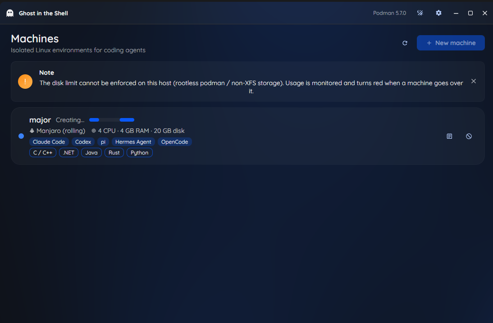

# Ghost in the Shell

A desktop manager for creating, starting, stopping, deleting and opening terminals into isolated Linux sandboxes (Ubuntu, Fedora or Manjaro) with coding agents (Claude Code, Codex, pi, Hermes, OpenCode) and development environments (C/C++, .NET, Java, Rust, Python) preinstalled. You set the CPU, memory, disk, login user and an optional shared host folder for each sandbox.

Built with [Avalonia 12](https://avaloniaui.net/) and [KD.Avalonia.Rice](https://github.com/k0zi/KD.Avalonia.Rice). The machines run as rootless [Podman](https://podman.io/) containers.



## Features

- **Create a machine**: pick a name, Linux distribution, CPU cores, memory, disk size, the coding agents and the development environments to install. The build log streams into the machine's card, and you can cancel the build.
- **User account** (second tab of the new machine dialog): the login user's name (default `agent`), its password for `sudo`, and the root (admin) password. Without a user password `sudo` works without one; without an admin password root login stays disabled. Passwords are set with `chpasswd` over stdin after the container starts and are never stored by the app, in the image or in labels.
- **Shared folder** (third tab of the new machine dialog): a host folder mounted read-write at `~/host` in the sandbox. Under rootless Podman the container runs with `--userns=keep-id`, mapping your host user onto the sandbox user, so files either side creates belong to you on the host. SELinux separation is switched off for that container instead of relabelling your folder. Leave it empty and nothing is mounted; no `~/host` folder is created either.
- **Start / stop / delete**: deleting asks for confirmation and removes the machine together with its home volume.
- **Open a terminal**: double-click a running machine's card (or use its terminal button) to open a login shell as the machine's user in your terminal emulator (Ptyxis, GNOME Terminal, Konsole, kitty, Alacritty, Ghostty, WezTerm, xterm, and others).
- **Live status**: the list follows `podman events`, so it also picks up changes you make with the `podman` CLI.
- **Disk usage**: shows the space each machine uses against its limit, and turns red when a machine goes over it.
- **Light and dark theme**.
- **Language**: the UI is in English by default; switch to Hungarian (Magyar) under Settings → Language.


### Supported distributions

| ID | Image |
|---|---|
| `ubuntu-24.04` | `docker.io/library/ubuntu:24.04` |
| `ubuntu-26.04` | `docker.io/library/ubuntu:26.04` |
| `fedora-43` | `registry.fedoraproject.org/fedora:43` |
| `manjaro` | `docker.io/manjarolinux/base:latest` |

### Supported agents

| Agent | Installed with |
|---|---|
| [Claude Code](https://claude.com/claude-code) | `curl -fsSL https://claude.ai/install.sh \| bash` |
| [Codex](https://github.com/openai/codex) | `npm install -g @openai/codex` |
| [pi](https://pi.dev) | `npm install -g @earendil-works/pi-coding-agent` |
| [Hermes Agent](https://github.com/NousResearch/hermes-agent) | official install script (`--non-interactive`); pulls in `libatomic` for its bundled Node.js |
| [OpenCode](https://opencode.ai) | `curl -fsSL https://opencode.ai/install \| bash` |

### Development environments

| Option | Installs |
|---|---|
| C / C++ | gcc, g++, clang, gdb, CMake, Ninja, pkg-config (distro packages) |
| .NET | .NET 10 SDK (LTS) via `dotnet-install.sh` into `/usr/local/share/dotnet` |
| Java | OpenJDK 25 (LTS, Eclipse Temurin build) into `/opt/jdk`, `JAVA_HOME` set |
| Rust | stable toolchain via `rustup` (cargo, rustc, clippy, rustfmt) |
| Python | pip, venv, pipx, dev headers (distro packages) and [uv](https://docs.astral.sh/uv/) |

These are optional: pick them per machine in the new machine dialog. An option is greyed out when it has no install command for the chosen distribution.

### Developer tools on every machine

Installed on every machine, whatever you select:

| Category | Tools |
|---|---|
| Version control | `git`, `git-lfs` |
| Search and files | `ripgrep` (`rg`), `fd`, `tree`, `file`, `mc` (Midnight Commander) |
| Editors and pagers | `vim`, `nano`, `less` |
| Network and transfer | `curl`, `wget`, `rsync`, SSH client (`ssh`, `scp`) |
| Data and archives | `jq`, `zip`, `unzip`, `xz`, `tar`, `gzip` |
| Terminal and system | `tmux`, `btop`, `procps` (`ps`, `top`, `free`), `sudo` |
| Security | `gnupg` (`gpg`), CA certificates |
| Build | `gcc`, `g++`, `make` (Ubuntu: `build-essential`, Manjaro: `base-devel`) |
| Prompt | [Oh My Posh](https://ohmyposh.dev), enabled in the user's `~/.bashrc` |
| Runtimes | Node.js 24 LTS with `npm`, Python 3 with `venv` |

Package names differ between distributions (for example Ubuntu's `fd-find` installs `fdfind`, so the app links `fd` to it); see the `setup` lines in [`catalog.json`](src/GhostInTheShell.Core/catalog.json).

Oh My Posh's default theme uses [Nerd Font](https://www.nerdfonts.com) icons. Fonts are drawn by your terminal on the host, not in the sandbox, so install a Nerd Font on the host and select it in your terminal (for example `sudo pacman -S ttf-meslo-nerd`, or `oh-my-posh font install meslo`). Without one the icons show up as boxes. To turn the prompt off in a machine, remove the `oh-my-posh init` line from `~/.bashrc`.

## Requirements

- Linux
- [.NET 10 SDK](https://dotnet.microsoft.com/download)
- Podman (rootless works): `sudo apt install podman` / `sudo dnf install podman`

## Getting started

```bash
git clone <repo-url>
cd GhostInTheShell
dotnet run --project src/GhostInTheShell.App
```

Run the tests:

```bash
dotnet test
```

### Install as a system package

`packaging/install.sh` builds a `.deb` or `.rpm` for your distribution and installs it with apt (Debian, Ubuntu), dnf (Fedora, RHEL) or zypper (openSUSE). It needs the .NET 10 SDK to build, but the package is self-contained and doesn't need a .NET runtime.

```bash
packaging/install.sh               # build and install (asks for sudo)
packaging/install.sh --no-build    # install the newest package already in artifacts/packages/
packaging/install.sh --uninstall   # remove it
```

The app goes to `/usr/lib/ghostintheshell`, with a `ghostintheshell` launcher in `/usr/bin` and a menu entry. The package recommends `podman`, so apt and dnf install it too. Your settings in `~/.config/ghostintheshell/` and your machines stay when you uninstall.

To build only the packages (x86_64), into `artifacts/packages/`:

```bash
packaging/build-packages.sh                  # tests, then .deb and .rpm
packaging/build-packages.sh --skip-tests deb # only the .deb, no tests
```

The script downloads [nfpm](https://nfpm.goreleaser.com) into `artifacts/tools/` (checksum-verified) if it isn't on your `PATH`, so it doesn't need `dpkg-deb` or `rpmbuild`.

**Versions** are `<year>.<month>.<patch>`, e.g. `26.10.3`, from [Nerdbank.GitVersioning](https://github.com/dotnet/Nerdbank.GitVersioning): `version.json` holds the year and month, and the patch is the number of commits since that line last changed. When a new month starts, `build-packages.sh` updates `version.json` to it (commit that change, `--no-bump` skips it). Builds from a branch other than `main` or a `v*` tag get a `~g<commit>` suffix, which sorts before the release of the same version. `dotnet tool restore && dotnet nbgv get-version` shows the current version.

The first machine for a given distro and agent combination takes a few minutes to build. Later machines with the same selection reuse the cached image and start in seconds.

## How it works

1. **Image**: the chosen distro, development environments, agents and login user become a Containerfile (`ContainerfileBuilder`). Each development environment and agent gets its own layer, and the user is created after the shared root layers, so machines with different users still share the build cache. The image is tagged by the Containerfile's content hash (`localhost/gits/<os>:<hash>`), so the same selection reuses the image, and any catalog change triggers a rebuild.
2. **Machine**: a container named `gits-<name>` with `--cpus`, `--memory`, `--init`, and a named volume `gits-<name>-home` mounted at `/home/<user>`. Podman copies the image's home directory into the empty volume, so installed agents and your files survive stop, start and image updates.
3. **State**: there is no database. Each machine's settings (but never its passwords) are stored as `gits.*` labels on its container, and the app reads them back with `podman ps`.
4. **Terminal**: `podman exec -it -u <user> -w /home/<user> gits-<name> bash -l`, placed into a terminal command template.

### Disk limits

Podman can only enforce the disk size (`--storage-opt size=`) with the overlay driver on XFS with project quotas, running as root. The app tries it first. If Podman rejects it, which is the usual case for rootless setups, the app creates the machine without it and only reports the disk usage. A banner in the app says which mode is active.

## Configuration

Files live in `~/.config/ghostintheshell/`:

| File | Purpose |
|---|---|
| `settings.json` | terminal command template, language and theme (editable from **Settings** in the app) |
| `catalog.json` | *optional*: replaces the built-in catalog of distributions, development environments and agents |

### Terminal template

`{cmd}` is replaced with the shell command, for example:

```
ptyxis --new-window -- {cmd}
gnome-terminal -- {cmd}
kitty {cmd}
```

On first run the app picks the first terminal it finds on your `PATH`.

### Custom catalog

Install scripts change. To fix or extend them without rebuilding the app, copy [`src/GhostInTheShell.Core/catalog.json`](src/GhostInTheShell.Core/catalog.json) to `~/.config/ghostintheshell/catalog.json` and edit it:

```jsonc
{
  "operatingSystems": [
    { "id": "debian-13", "displayName": "Debian 13", "image": "docker.io/library/debian:13",
      "family": "debian",                  // picks each toolchain's install command
      "setup": "apt-get update && apt-get install -y curl git sudo ..." }
  ],
  "commonSetup": [ "..." ],               // root commands run on every distro (Node.js, Oh My Posh)
  "userSetup": [ "..." ],                 // commands run as the machine user on every distro (shell prompt)
  "toolchains": [
    { "id": "go", "displayName": "Go", "description": "...",
      "root": { "debian": "apt-get update && apt-get install -y golang",   // per family, as root
                "*": "..." },                                               // fallback for any family
      "user": "...",                                                        // optional, as the agent user
      "check": "go version" }
  ],
  "agents": [
    { "id": "myagent", "displayName": "My Agent", "description": "...",
      "root": { "fedora": "dnf install -y libatomic" },                  // optional: root prerequisites, only when selected
      "install": "curl -fsSL https://example.com/install.sh | bash",   // runs as the agent user
      "check": "myagent --version" }                                    // fails the build if the install broke
  ],
  "userPath": [ "~/.local/bin" ]            // ~ is the machine user's home
}
```

### Translations

UI text lives in [`src/GhostInTheShell.Core/Localization`](src/GhostInTheShell.Core/Localization): `Strings.resx` is English, `Strings.<code>.resx` holds a translation. To add a language, copy `Strings.hu.resx`, translate the values, and add the code to `Strings.Languages`. A test checks that every translation has every key and the same `{0}` placeholders.

## Project layout

```
src/
  GhostInTheShell.Core/     models, IVmProvider, catalog, Containerfile generation (no UI)
  GhostInTheShell.Podman/   PodmanProvider — drives the podman CLI
  GhostInTheShell.App/      Avalonia + KD.Avalonia.Rice desktop app (MVVM, CommunityToolkit.Mvvm)
tests/
  GhostInTheShell.Tests/    xUnit tests
```

All backend calls go through `IVmProvider`, so you can add another backend (QEMU/KVM, VirtualBox, Incus) as a new provider without changing the UI.

## Security notes

- The machines are **containers, not VMs**: they share the host kernel. Rootless Podman keeps them isolated from your user account, but they don't give you the isolation of a hypervisor.
- A shared folder is fully writable from the sandbox, and so by any agent running there. Share a project folder, not your whole home.
- The login user has sudo **inside** the container: with its password if you set one, otherwise without a password.
- Agent install scripts are downloaded from their vendors and run at build time. Review `catalog.json` if that matters to you.

## License

Ghost in the Shell is licensed under the [MIT license](LICENSE). The packages also redistribute third-party components (the .NET runtime, Avalonia, SkiaSharp/HarfBuzz, the Inter font, Material Design Icons, KD.Avalonia.Rice and its theme palettes, …) under their own licenses; see [THIRD_PARTY_NOTICES.md](THIRD_PARTY_NOTICES.md) and the `licenses/` directory. The packages install these to `/usr/share/doc/ghostintheshell/` (deb) and `/usr/share/licenses/ghostintheshell/` (rpm).
